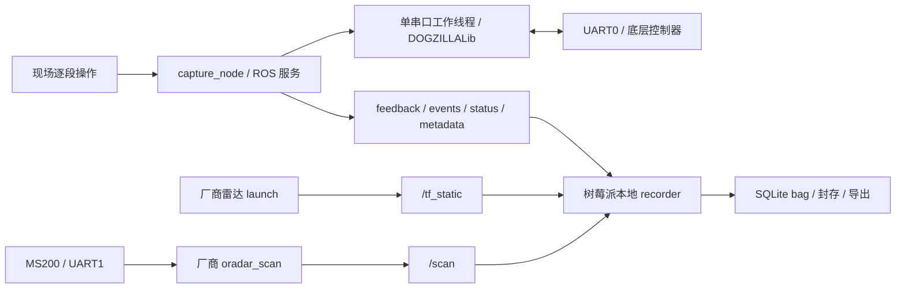

# A 模块如何使用阶段数据

编写于 2026-11-18。用于核实 A 的传感器、状态、时间戳和运动接口。选轮次、回放及文件全路径见[数据包与离线复现](device-motion-data-package.md)。本页以随包部署清单、消息定义和已采集 payload 为依据。

## 采集时的数据通路

采集部署使用 Pi 5 Debian 12 arm64 宿主、厂商 Ubuntu 22.04.4 / ROS2 Humble 容器，临时交接 UART0，复用未改厂商库与雷达驱动。UART0 上的控制写入和反馈查询由同一个硬件线程管理，UART1 由雷达驱动占用。相机节点和视频设备未接入。阶段档案中的 `config.json`、`deployment.json`、`handoff/` 记录实际启动、资源和文件身份。整机开发仍按 D→C→A 接收运动指令。采集入口与串口排他实现见[ROS 控制与反馈入口](device-capture-entry.md)和[部署报告](../report/device-motion-stage-capture-2026-11-11.md#1-环境与范围)。

## 扫描和静态 TF

| 证据 | 消费语义 | A 的后续交付 |
| --- | --- | --- |
| `/scan`，frame 为 `laser_frame`，距离为米、角度为弧度 | 每帧按 `len(ranges)`、`angle_min + i * angle_increment` 和自身量程字段解释。厂商角度端点按点数计算，端点与数组长度推算会有差异。零值、NaN、非有限和越界点单独处理。填桶与强度关联按厂商语义核对 | 向 B/C 提供数组、方向、有效值和需保留的未知空间语义。实测机身正前方对应的角度、盲区和近距离响应 |
| 动态首帧 449 点，整轮 439–457；每帧至少 425 个量程内有效点 | 点数会变化。量程字段约 0.05–20 m，是驱动声明范围。有效点计数是数值检查 | 输出代表样本与覆盖统计，另记录实测精度和可用距离 |
| 动态约 10.037 Hz，最大收录间隔 0.15882 s，最大 header 间隔 0.10307 s | 这是该轮观测值。header 在主机等待整帧前生成，`scan_time` 是等待耗时，`time_increment` 是该耗时按点数分摊。header 到收录中位约 0.099 s，包含驱动与收录等待 | 说明时间戳来源及可用性，给出中断检测依据。去畸变需要额外硬件时序或实测依据 |
| `/tf_static` 含 `base_link → laser_frame`，厂商平移 `(0,0,0.18)` m、零旋转 | 可供离线消费测试。安装位置、方向和机身实际几何待测 | 确认实际外参、命名和唯一发布者，和 B/D 核对集成 TF |
| 实机审计看到雷达发布端 reliable/volatile，动态录制对 `/scan` 使用 best effort 订阅 | `metadata.yaml` 的 offered QoS 字段为空。实际部署与回放的 QoS 分别核对，尤其是只发一条的静态 TF | 交付支持的 QoS、晚加入获取方式及对应测试 |

首帧范围与时间见 `verification/quality_analysis.json`，整轮数值分布见 `verification/scan_payload_check.json`。驱动角度重排、无效桶、硬件时间和 QoS 的证据见[厂商接口审计](../report/dogzilla-interface-audit-2026-11-05.md#2-ms200-的-laserscan-接口)和采集源码 [recording.py](../../src/dogzilla_device_capture/dogzilla_device_capture/recording.py)。

## 原始反馈和状态

| `Feedback.method` | 静止（bag 内） | 动态（bag 内） | 当前用途 |
| --- | ---: | ---: | --- |
| `read_imu_raw` | 2,397 有效 | 11,130 无效 | 用静止样本核对九项结构、协议及查询频率。动态记录用于测试无效值处理 |
| `read_motor` | 1,199 有效 | 5,587 无效 | 用静止样本核对厂商顺序和原始字节。动态记录用于验证关节来源不可用时的报告 |
| `read_battery` | 121 有效 | 563 有效 | 核对厂商原值与设备状态显示，单位和精度另证 |
| `read_roll`、`read_pitch`、`read_yaw` | 各 121 有效 | 各 562 有效 | 检查独立查询返回和协议质量，待测单位、轴向、符号和参考零点 |

- `Feedback` 先按 `session_id` 和 `method` 归类，再读 `sequence`、`valid`、`error`。只有 `valid=true` 的记录可以进入该方法的协议有效样本集。在原始反馈中保留 `values`、`text` 和 `chunks`，据此追踪失败和迟到字节。请求和返回时间记录在 `wall_*_ns`/`mono_*_ns`，物理采样时刻仍未知。
- 动态两种无效方法的错误均为 `attribution_uncertain_pending_response`。中断后没有可靠的响应序号可确认归属，同地址会保留未决状态，其中的无效记录可能为占位。以缺失上报并保留错误，让 B/C 消费明确的可用性。动态融合须等同过程有效样本和标定。恢复条件按[入口的迟到响应说明](device-capture-entry.md#中断迟到响应与关闭)核实。
- `CaptureStatus` 的 `state`、`enable_motion` 和 `current_request_id` 表示入口的状态。 `feedback_count`、`invalid_feedback_count`、`last_error` 支持判断反馈质量。计数始于入口会话，可能已经累计准备阶段记录。bag 内按方法和有效位统计。`CaptureMetadata` 的键值数组及 `firmware` 描述后端、参数和固件响应。以包内 `msg/` 为 schema。
- `valid` 覆盖协议、响应归属及方法格式。要提供标准 `Imu` 或 `JointState`，还需确认单位、轴向、顺序、坐标系、样本新鲜度及下游所需的质量信息。静止样本可用来检查静态偏置和数值稳定性，实际动态特性与标定需要专门数据。字段见 [Feedback.msg](../../src/dogzilla_capture_interfaces/msg/Feedback.msg) 与 [CaptureStatus.msg](../../src/dogzilla_capture_interfaces/msg/CaptureStatus.msg)。

## 运动与停止接口的证据

用 `request_id` 关联受理、清轴、运动写入、到时和停止写入事件。 `REQUEST_ACCEPTED.detail` 保存动作、输入量级和计划持续时间，`MOTION_WRITTEN.detail` 增加单调时间起点与期限。阶段事件支持复查串口软件写入顺序和实际软件期限。用随包 `operator_observations.json` 提供的现场约值描述机器人响应。停止写入、现场停稳、停止踏步、失联超时和强制断电应分别交证据。正式连续指令及 A 执行侧兜底仍按[阶段决议 §7.2、§7.26](../architecture/interface-baseline-decisions.md)细化。厂商命令系数和停止函数见[厂商反馈协议审计](../report/dogzilla-interface-audit-2026-11-05.md#3-dogzillalib-反馈协议与返回值)。

## 以什么结果交接

1. **数据接口**交接表覆盖话题、类型、帧、QoS、时间戳、有效性与错误，给 B/C 一条静止有效反馈、一条动态无效反馈和一份可读扫描样例。有效性可由样例逐条复验。
2. **设备故障**分别记录无发布者、可见发布者但零数据、读到消息但方法无效、过期和关闭失败，给 D 对应轮次、日志和恢复证据。关闭分析关联雷达子进程、入口 audit 和资源释放结果。
3. **待补测**给出外参与扫描方向的实测、动态原始反馈恢复及标定路径，按 B/C 的消费阻塞项排序。要声明三个档位的速度，使用已知线距、同一机身参考点和跨线时间的测量口径，保留重复性和误差。左右转分别测量实际角度、用时和伴随平移。
4. **运动交接**给 C/D 明确接口的执行结果、超时责任和可核实的停止能力。将软件事件与现场观测分别记录，保留未证实的底层断电、踏步和失效能力。
