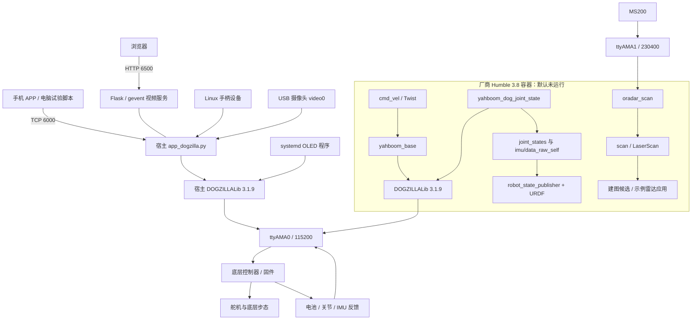
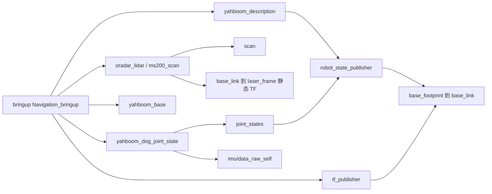

# DOGZILLA 实机系统架构、依赖与开发接入调查

检查日期：2026-11-05（操作者所在 Asia/Shanghai 日期）。对象：当前 DOGZILLA S2 / Pi 5 系统卡；通过热点 `192.168.8.88` SSH 检查。机器人时钟未同步，返回 2026-11-04 UTC，不能用其日志日期替代本报告检查日期。

本文回答“系统由什么组成、怎样启动和相互调用、项目应该接入哪里”。具体函数、消息字段、单位、QoS 和数据缺陷见[接口附录](dogzilla-interface-audit-2026-11-05.md)。原环境版本与此前运动试验保留在[版本及连接报告](pi5-image-version-audit-2026-11-02.md)。建议不自动成为 A/B/C/D 已确认接口。

## 1. 结论与证据边界

现有系统分为 **底层运动控制器、Debian 宿主应用、Humble 容器内的 ROS 示例、维护工具**。目前日常开机运行的是宿主 APP/OLED 路径；ROS 示例不是一个已在后台完整运行的建图系统。

本次检查覆盖宿主进程/服务/网络/设备占用、启动入口、厂商 Humble 3.8 的工作空间源码与安装树、控制库、主要 launch 依赖和传感接口。额外执行一次隔离的 MS200 实际数据读取。未发送运动指令，未修改厂商代码、持久配置、系统时间或现有服务；未安装软件，未构建或运行整机 launch。

| 证据等级 | 本轮结果 |
| --- | --- |
| 运行事实 | APP/OLED 正在运行，控制串口被二者打开；当前无常驻容器；无线 SSH 可用 |
| 实际传感数据 | 单独启动 MS200 驱动，收到 119 帧 LaserScan，约 10.026 Hz；退出时驱动异常终止 |
| 源码事实 | ROS 运动、IMU/关节、TF、视觉、示例避障和地图保存的接口及调用链已追踪 |
| 尚未验证 | IMU/关节真值与质量、跨机 DDS、长时间录制、驱动构建复现、完整建图、固件内部实现和强制断电能力 |

“彻底探查”在此指把当前可见软件层、关键依赖和接入缺口梳理出来；不等于对所有系统包、所有示例、固件二进制或硬件电路完成穷尽验证。3.5–3.7 镜像仅登记，未逐个深入；主调查对象为厂商启动脚本实际选择的 3.8。

## 2. 整机分层与两条控制路径

底层控制器的实际芯片、固件版本、闭环控制算法和断电电路本轮未读取或拆查。Python 库是串口协议封装，不是步态算法本身。`champ` 名称出现在镜像中，也不证明当前机器狗在运行 CHAMP 步态。

此前成功前进的路径是“SSH 启动临时 Python → 机器人本机 TCP 6000 → APP `parse_data()` → `move_x()/move_y()` → 串口”；停止经 `stop()` 清零平移、踏步和转向。本次确认宿主与容器的 **3.1.9 主库源码字节相同**，因此可以复用同一底层接口知识；ROS 上层和 APP 协议仍是不同入口。

## 3. 宿主系统：开机后实际运行什么

### 3.1 启动依赖

| 入口 | 启动对象 | 对设备/服务的依赖 | 当前状态 |
| --- | --- | --- | --- |
| `/home/pi/.config/autostart/app.desktop` | `lxterminal → bash → app_dogzilla.py` | 图形桌面、Python3.11、DOGZILLALib、OpenCV、Flask/gevent、UART0、摄像头、热点地址 | 正在运行，PID 1399 |
| `/etc/systemd/system/yahboom_oled.service` | `oled_dogzilla.py`，用户 pi | DOGZILLALib、UART0、电池读取、I²C 显示 | active，PID 1891 |
| `NetworkManager` | `DOGZILLA_WIFI` 热点连接，dnsmasq | wlan0、DHCP/DNS | wlan0 为 192.168.8.88；eth0 DOWN |
| `jupyter.service` | Jupyter Lab | 宿主 Python 教学环境 | 8888 监听 |
| `ssh.service`、`wayvnc.service` | 远程 shell、桌面 | 网络 / 图形系统 | 22、5900 监听 |
| `/home/pi/run_humble.sh` | `docker run ... ros-humble:3.8 /bin/bash` | Docker、设备挂载、显示转发 | 手动入口；检查前无容器 |
| `/etc/rc.local`、pi crontab | 无机器人 ROS 启动链 | rc.local 仅显示 IP，pi 无 crontab | 未发现这里自动启动 ROS |

APP 在入口中启动 TCP、手柄和动作处理线程；当独立 OLED service 未 active 时才启动其内部 OLED 线程。即使独立 OLED 已运行，APP 自身仍持有控制库实例，因此“避免重复显示线程”不等于“只有一个串口所有者”。APP 启动末尾有 `motor_speed(50)` 和 `action(14)`，不宜为读取信息而随意重启。

### 3.2 端口与设备

| 资源 | 已知用途 | 项目意义 |
| --- | --- | --- |
| `192.168.8.88:6000/TCP` | 厂商自定义 APP 控制协议，仅绑定热点 IP | 之前运动试验入口，不是 ROS topic 或动作确认接口 |
| `0.0.0.0:6500/TCP` | `/` 页面、`/video_feed` MJPEG、`/init` 初始化入口 | 可作为现有观察入口；`/init` 有初始化副作用，不能当健康检查 |
| `22/TCP` | SSH | 推荐作为部署、诊断、启动机器人本地采集的管理通道 |
| `5900/TCP`、`8888/TCP` | VNC、Jupyter | 开发/教学工具，非 A/B/C/D 数据总线 |
| `53`、`67/UDP` | 热点 DNS/DHCP | 连接基础设施 |
| `/dev/ttyAMA0` | 运动控制及反馈，115200 | 当前 APP、OLED 同时打开；将来 A 必须协调访问 |
| `/dev/ttyAMA1` | MS200，230400 | 检查前空闲；本次实测可获取扫描 |
| `/dev/video0` | USB 摄像头 | APP、PipeWire、WirePlumber 有打开记录；ROS 摄像头节点不能假定可独占 |
| I²C | OLED（源码默认 bus 1） | 显示路径，未进行总线扫描 |

USB 枚举显示 `0c45:6368 Microdia USB 2.0 Camera`，未见 USB 雷达设备；这与 MS200 走 UART1 的配置及实测相符。`/dev/video19` 等多个视频节点不能当作多台实体摄像头。系统存在 rplidar/myspeech 的 udev 规则，不代表对应硬件当前已接入。

### 3.3 宿主文件组织

- `/home/pi/DOGZILLA/app_dogzilla/`：APP、摄像头、手柄、OLED 及页面服务。
- `/home/pi/DOGZILLA/Samples/`：独立教学示例，不能当作常驻服务清单。
- `/usr/local/lib/python3.11/dist-packages/DOGZILLALib-3.1.9-py3.11.egg`：宿主实际安装库。
- `/home/pi/run_humble.sh`：ROS 容器入口。
- `/etc/systemd/system/`、桌面 autostart：服务与图形应用启动入口，两套机制并存。

## 4. 容器系统与 28 个源码 package

镜像为 `yahboomtechnology/ros-humble:3.8`，ID `sha256:7e79c61b64b81311caf297640e5c6fd70279be4cbd38c2c087e8e3395e566047`。Ubuntu22.04/Humble/Python3.10；与宿主 Debian12/Python3.11 分开。`/root/yahboomcar_ws` 包含 src/build/install/log，src 内还有嵌套安装产物，不能按所有 package.xml 数量直接计算独立包。

以下 28 个包按顶层源码 package.xml 去重；分组表示职责，不表示全部启动或都能运行：

| 类别 | package | 主要依赖/作用 | 后续关注方 |
| --- | --- | --- | --- |
| MS200 驱动 | `oradar_lidar` | C++ Oradar SDK、串口、rclcpp、LaserScan | A；B/C 消费扫描 |
| 其他雷达示例 | `ydlidar_ros2_driver`（目录 `yahboomcar_ydlidar`） | YDLidar SDK、另一组设备参数 | 当前 MS200 不使用 |
| 运动适配 | `yahboom_base` | rclpy、Twist、DOGZILLALib | A/C |
| 状态采集 | `yahboom_dog_joint_state` | DOGZILLALib、JointState、Imu、NumPy | A/B |
| 模型/TF | `yahboom_description`、`tf_publisher` | xacro、robot_state_publisher、tf2_ros | A/B/D |
| 设备启动 | `bringup` | 雷达、状态、模型、base、TF 的组合 | D/A |
| 高层示例启动 | `yahboom_bringup` | Cartographer、视觉及外部导航包引用 | B/D，部分引用缺失 |
| 雷达应用 | `yahboom_laser` | `/scan`、`/JoyState` → `/cmd_vel`，避障/追踪/巡线 | C 参考，不可直接充当保护层 |
| 姿态/步态演示 | `yahboom_gait`、`yahboom_set_height` | 订阅 cmd_vel 并直接调用库 | 不宜和 base 同时作为运动执行者 |
| 地图保存演示 | `yahboom_app_save_map` | 自定义服务、SQLite、nav2_map_server 子进程 | B/D，依赖及完成语义不完整 |
| 摄像头与视觉 | `yahboom_publish`、`yahboom_visual`、`yahboom_mediapipe` | OpenCV、cv_bridge、摄像头/图像话题、MediaPipe | A 可选图像采集；不属于激光建图必需链 |
| 颜色/二维码行为 | `yahboom_color_tracking`、`yahboom_color_identify_server`、`yahboom_color_staus_redis`、`yahboom_qrcode`、`yahboom_qrcode_tracking` | 自定义消息、识别服务、Redis、部分运动指令 | 示例层，默认不加入项目启动 |
| 语音/多目标行为 | `voice_xgo_ctrl_run` | Speech_Lib、视觉、Twist、文件通信等，部分直接调用控制库 | 示例层，不等于统一遥控入口 |
| CHAMP 示例 | `champ`、`champ_bringup`、`champ_msgs` | 配置、URDF、控制/估计等外部依赖 | 未运行，不替换现有底层步态 |
| 自定义消息/服务 | `yahboom_msgs`、`image_color_lab`、`yahboom_color_identify_interfaces`、`yahboom_attitude_record_interfaces` | rosidl、标准消息 | 按消费者需要接入，不必全盘沿用 |

很多 Python package.xml 仅声明测试依赖，实际运行 import 比清单多；仅看 manifest 会遗漏 DOGZILLALib、OpenCV、NumPy、Redis 及跨包运行依赖。本次同时审读 setup.py、import、Node/IncludeLaunchDescription 和消息创建代码。

额外目录：`/root/ROS_UDP/dog_udp_server.py` 提供 UDP5578 → `ROS2.txt`/`ROS2cc.txt` 文件交换（如 APoint/APointGet），对应 `voice_xgo_ctrl_run/ros2_dog_agent.py`；当前未监听5578，未执行此路径。`/root/py_install_v0.0.3` 为 Speech_Lib 源码，另有旧0.0.1目录；`/root/YDLidar-SDK` 是另一雷达SDK；这些不是当前运动成功链所需组件。

## 5. 厂商 ROS 默认组合与断点

较完整的设备入口是 `bringup/launch/Navigation_bringup.launch.py`（名称虽含 Navigation，实际返回的主要是设备节点）：

这个组合尚未运行验证，并存在以下明确阻碍：

1. **TF 冲突：** URDF 固定边 `base_footprint → base_link` 为 `(0,0,0.010)`；tf_publisher 以10Hz发布同一边 `(0.1154,0,0.047)`。需由 A/B/D 确定唯一发布者及实际外参。
2. **串口争用：** base 与 joint 节点各自实例化 DOGZILLA，叠加宿主 APP/OLED 会出现多个读写者；库读取会清空输入缓冲。不能把它们当作互不影响的模块。
3. **IMU 质量语义：** 状态节点用 accx 是否为零判断有效性，可能沿用旧样本并赋新时间；回调内 sleep0.1 与标称0.05s定时器冲突。详见附录。
4. **部分入口无法解析：** AST 静态检查确认 `bringup/launch/Mapping.launch.py` 和 `bringup.launch.py` 第2行是不完整 import，语法错误。未执行这些入口。
5. **高层依赖不完整：** `yahboom_bringup` 引用 `cartographer_ros`、`xgo_bringup`、`localization_server` 等；源码有 `NODE` 大小写错误、旧参数名、其他电脑的绝对路径。所查源码/安装包索引未找到完整 Cartographer、slam_toolbox、Nav2 地图/定位链，不能把 launch 文件存在等同于算法可用。
6. **保护目标不相同：** `yahboom_laser` 示例会自己生成平移/转向命令，而项目 C 要限制 D 的持续操作意图。示例不是可直接串入的保护过滤器。
7. **地图保存不完整：** 服务启动 map_saver 子进程后没有等待退出并核实产物；数据库及地图路径硬编码到 `/home/yahboom/cartoros2/data/`，没有完整状态保存/原子替换流程。

设备入口中外置 `wit_ros2_imu` 和地图保存 include 虽被构造，但不在最终有效启动列表中；不能把这些变量全部画成已启动节点。安装树与源码中的雷达 launch、该设备 launch、base.py、joint_state.py 本次逐字比对一致；未证明现有 C++ 二进制由当前源码可复现构建。

## 6. 已验证的雷达数据与退出故障

单独启动安装树的 `oradar_scan`，使用厂商 MS200 参数，但不运行附带 TF 的 launch，更不运行整机控制。容器 `--network none --read-only --cap-drop ALL --security-opt no-new-privileges`，只映射 `/dev/ttyAMA1`，临时日志放 tmpfs；同一容器内 rclpy 订阅 `/scan`。检查脚本有本地采集截止时间和进程超时。

| 项目 | 结果 |
| --- | --- |
| 接口 | `/scan`，`sensor_msgs/msg/LaserScan`；节点 `oradar_ros`（直接执行时） |
| 帧与频率 | 119帧；首末接收间隔11.769240s；约10.026136Hz |
| 首帧 | frame=`laser_frame`；450个range和450个intensity |
| 首帧有效性 | 438个区间内有限值，8个零，4个NaN |
| 首帧有效距离 | 0.170–3.985m；只是当前视野观测，不是精度校准 |
| 范围声明 | range_min≈0.05m，range_max=20m；不代表实测20m性能 |
| QoS发现 | RELIABLE、VOLATILE；发现接口返回history UNKNOWN、depth0，不能当作已测队列深度 |
| 首帧时间 | scan_time≈0.015875s；与约0.1s发布周期不同，源码取的是阻塞等待耗时 |
| 退出 | SIGINT后 `*** buffer overflow detected ***: terminated`，returncode=-6 |
| 清理 | 容器已删除，ttyAMA1无占用；APP/OLED原PID仍在 |

实际已证明“本机雷达 → 安装驱动 → ROS消息 → 订阅者”能够通，但未证明优雅退出、持续稳定性、几何精度、运动中的时间一致性或跨机 DDS。退出故障的根因未确定，不能仅凭该字符串归因于SDK某一行；也不能宣称修复完成。后续应在无运动条件下复现退出，并核对构建/库版本，再决定原版依赖版本或最小外围处理方式。

## 7. 面向 A/B/C/D 的接入建议

| 模块 | 优先调用/复用对象 | 需要自己补的边界 | 本次是否实现 |
| --- | --- | --- | --- |
| A 设备 | 原版 `oradar_lidar`、原版 DOGZILLALib、必要的模型配置 | 单一控制串口所有者、反馈有效性/时间/单位、指令超时停车、唯一传感TF | 否；仅雷达单独读取已实测 |
| B 建图 | A 的 scan、核实后的IMU/反馈；单独选择并补齐估计/建图组件 | 不以cmd_vel当里程计；地图完整保存、状态与失败契约 | 否 |
| C 保护 | A 扫描与运动/停止接口，D 的操作意图 | 持续操作、障碍检查、超时与恢复；不能直接套厂商自动避障行为 | 否 |
| D 集成 | Docker/launch、无线SSH管理、模块状态、录包工具 | 启停顺序、资源互斥、持久目录、时间基线、日志和模式协调 | 否 |

推荐的组织方向仍为“项目自有集成包 + 未修改厂商底层库/驱动”，而不是修改厂商大目录或把每个教学包都启动。最终运动路径继续是 **用户 → D → C → A → DOGZILLALib → 底层控制器**；APP直连仅作为已经验证过的独立厂商路径，不能与项目运动执行者无协调并行。

### 首份数据录制之前的具体检查顺序

1. A/D 先处理雷达退出异常、统一时间与存储目录；保持厂商源码原样，保留本次二进制和源码身份。
2. A/D 明确 UART0 所有权和 APP/OLED 运行方式，再读取 IMU/关节；本轮没有为读取这些数据另开 UART0，避免与现有服务抢读。
3. A 核对扫描正前方向、外参、时间字段、无效点处理和失效上报；B/C确认实际消费需求。
4. B/C/A 确认逐项数据及运动接口；D建立独立项目launch，避免TF双发布和多个运动执行者。
5. 先机器人本地录包、录后经Wi-Fi取回，实测频率/丢帧/磁盘增量；跨机DDS另验。已有短时Wi-Fi测试不能替代长时间采集验证。

这些是调查后的建议排序，不是新确定的具体参数、项目实现或团队验收结果。

## 8. 部署限制与可复现证据

- 时钟：`timedatectl` 为 `System clock synchronized: no`、NTP active；RTC显示1970年。后续录包须先核实时间来源，不能仅因NTP服务active认为已同步。本轮未校时。
- 存储：根分区约30GiB、已用23GiB、可用5.1GiB（82%）；内存约4GiB、可用3.3GiB，均为当时快照，不是负载测试。
- 持久化：原 run_humble.sh 映射设备和X11，但没有项目/录包数据目录映射。若把录包放容器可写层，移除容器会丢失；D需要显式持久化路径。本轮没有录制正式rosbag。
- DDS：容器交互 `.bashrc` 设置 `ROS_DOMAIN_ID=12`，source Humble 与工作空间；非交互 shell 不自动等价。SSH可达不表示DDS已配置。本轮雷达检验只用隔离容器内通信。
- 运行库：easy-install.pth选择3.1.9；磁盘另存2.0.7 egg，版本目录存在不等于实际导入。未实例化控制库进行探查。
- 未安装：查询范围内缺失候选算法包是当前镜像缺口，不证明其他镜像/外部磁盘绝无这些软件。

关键身份：

| 对象 | SHA256 |
| --- | --- |
| 宿主3.1.9、容器3.1.9及/root/DOGZILLALib主源码 | `3d05141c71b1066e2274cb0d842bd45b328c6d57a9032b7484494433b185585d` |
| 安装雷达二进制 `/root/yahboomcar_ws/install/oradar_lidar/lib/oradar_lidar/oradar_scan` | `3b722a39916767ee5d0f3f3168c8f2fc983b1871498b89334b2d09a6022676a0` |
| MS200 launch源码 | `daf07c6d00b1a40fda0d57157295cf8a32d3a124eeb99cc4f2cead94d3bd4880` |
| `bringup/launch/Navigation_bringup.launch.py` | `1546f7e6e8f915825bad7f0095be0c3c0f1350d8727459dfea8ef177f27fbc42` |

本地过程材料位于 `.scratch/system-audit-2026-11-05/`：`host_files.json`、`image_files.json`、只读采集脚本、`probe_scan.py`、`scan_probe.log` 及文本展开副本；它们是本地证据，不保证随仓库分发。正式结论和接口字段已写入本报告与附录。源码快照包含1313项镜像文本条目、99项宿主文本/状态条目，含安装树重复项，不等于1412个独立模块。

## 9. 一手证据定位

### 同日补查：64GB 存储卡与约 5GiB 可用空间

用户询问容量差异后，再次通过 SSH 只读检查 `lsblk -b`、`fdisk -l /dev/mmcblk0`、`df -B1`、`tune2fs -l`、`docker system df` 和目录占用。未调整分区、文件系统或删除数据。

| 层级 | 实测容量 | 解释 |
| --- | --- | --- |
| 整张卡 `/dev/mmcblk0` | 62,534,975,488 bytes，58.240GiB | 内核报告的设备容量；用户标称64GB，十进制GB与二进制GiB也有区别 |
| 启动分区 p1 | 512MiB | FAT32，挂载 `/boot/firmware` |
| 根分区 p2 | 30GiB | ext4，挂载 `/` |
| 卡尾未分配区域 | 29,781,655,552 bytes，27.736GiB | 总扇区122138624减根分区结束后位置63971328，再乘512；不在当前根分区内 |
| 根文件系统 df 总容量 | 29.431GiB | 分区与文件系统可计量数据空间不同，存在元数据开销 |
| 根文件系统已用 | 22.870GiB | 24,556,126,208 bytes |
| 普通用户可用 | 5.066GiB | 5,439,627,264 bytes；此前约5GB印象对应此项 |
| ext4 保留块 | 1.480GiB | 387970块 × 4096bytes；解释部分“总量减已用”与普通用户可用的差额 |

结论：卡没有全部分给现有文件系统，容量差异不能只用GB/GiB解释。分区布局与“写入较小镜像后未扩展”相符，但本轮没有核实刷卡历史，不能认定这一成因。若后续决定扩容，应先备份，再扩展根分区及ext4文件系统；本次没有执行扩容。

目录占用快照：`/var`约9.6GiB（其中lib约7.0GiB、cache约1.8GiB、log约772MiB）、`/usr`约7.2GiB、`/opt`约4.4GiB（Wolfram约4.0GiB，Scratch 3约420MiB）、`/home`约1.6GiB。这些目录与子目录不能重复相加。

Docker当前无容器；4个镜像合计实际占用按`docker system df`为6.732GB（十进制，约6.27GiB），不能把各tag显示的6GB多逐项相加，共享层会重复计算。Docker显示100% reclaimable只是没有容器引用，不代表厂商镜像对项目无用，不据此删除。

### 两份控制库的含义

宿主的Python3.11和容器的Python3.10各安装一份DOGZILLALib，以供各自进程导入；主库源码相同，共用同一个底层控制器和UART0。这是两个软件运行环境，不是两套物理机器狗或两个独立步态控制器。

宿主提供APP、手柄、OLED等已有功能，容器提供Ubuntu22.04/Humble开发环境。这样的隔离可使Debian宿主与Humble用户态依赖并存；这是从现有布局推导的技术作用，未取得厂商关于设计动机的声明。原run_humble.sh手动启动交互shell，检查时无容器，因此应描述为“默认未自动启动的ROS环境”；镜像仍存储在卡上，并不因没有运行而不占空间。

路径均指本次机器人宿主或上述固定镜像；具体函数行号与更多hash见接口附录。

| 结论 | 原始证据 |
| --- | --- |
| 实际启动和占用 | systemctl、ps、ss、fuser、docker ps；宿主app.desktop与yahboom_oled.service |
| APP、视频、手柄、OLED调用关系 | `/home/pi/DOGZILLA/app_dogzilla/{app_dogzilla,camera_dogzilla,joystick_dogzilla,oled_dogzilla}.py` |
| 容器配置与domain | `/home/pi/run_humble.sh`、镜像`/root/.bashrc` |
| 包清单及依赖 | `/root/yahboomcar_ws/src/*/package.xml`、setup.py、CMakeLists.txt、launch文件及import；安装ament索引 |
| 运动/状态/TF链 | `yahboom_base/base.py`、`yahboom_dog_joint_state/yahboomcar_joint_state.py`、`yahboom_description/urdf/yahboom_xgo_rviz.xacro`、`tf_publisher/tf_publisher.py`（相对各包） |
| 高层链缺口 | `bringup/launch/`、`yahboom_bringup/launch/`、`yahboom_app_save_map/yahboom_app_save_map.py` |
| 真实雷达与异常 | 本节固定hash二进制、`scan_probe.log`中119帧统计与SIGINT后退出信息 |
| 标准消息契约 | 镜像`/opt/ros/humble/share/sensor_msgs/msg/{LaserScan,Imu}.msg`；网络文档访问受限时直接核对本机安装定义 |

本轮未发布GitHub issue、未提交或推送仓库文件，未把上述建议写成新的阶段决议。
